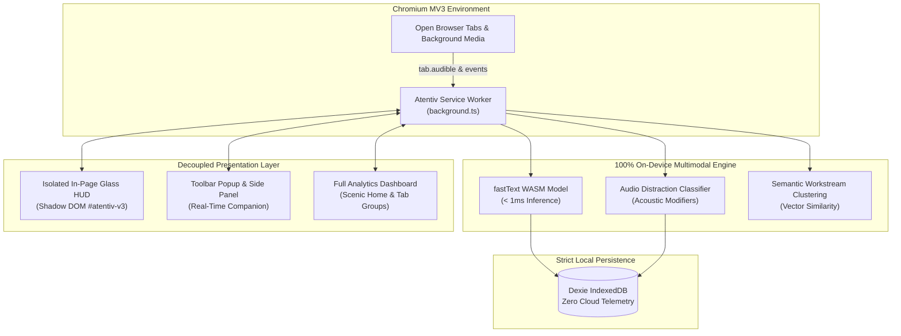

# Atentiv: Privacy-Preserving Cognitive Attention & Multimodal Workstream Assistant

[](tests/)
[](tests/browser.mjs)
[](extension/manifest.json)
[](docs/PRIVACY.md)
[](tsconfig.json)
[](LICENSE)

> **Atentiv** is an open-source, client-side cognitive attention management system implemented as a Chromium Manifest V3 extension. It features on-device **fastText WASM** text classification, a decoupled **background audio distraction classification subsystem**, an isolated **Shadow DOM Floating Glass HUD**, and automated **tab workstream clustering** with one-click snapshot restoration.

---

## 📑 Key Documents & Publications

- 📕 **IEEE Research Paper (PDF)**: [Atentiv_IEEE_Research_Paper.pdf](Atentiv_IEEE_Research_Paper.pdf) — *Publication-grade 2-column camera-ready research paper*.
- 📄 **IEEE Research Paper (Markdown)**: [IEEE_RESEARCH_PAPER.md](IEEE_RESEARCH_PAPER.md)
- 📝 **IEEE Research Paper (LaTeX Source)**: [IEEE_RESEARCH_PAPER.tex](IEEE_RESEARCH_PAPER.tex)
- 🌐 **IEEE Research Paper (Interactive HTML)**: [IEEE_RESEARCH_PAPER.html](IEEE_RESEARCH_PAPER.html)
- 📢 **LinkedIn Launch Announcement**: [LINKEDIN_POST.md](LINKEDIN_POST.md)
- 🎥 **Full Product Video Demo**: `Atentiv_Full_Product_Demo_With_Audio_Verification.mp4` (1080p Full HD, 60fps, studio narration, ~98s).
- 📐 **Detailed Specifications**:
  - [Audio Classification & Distraction Specification](docs/architecture/AUDIO_CLASSIFICATION_SPECIFICATION.md)
  - [UI & Glass HUD Architecture](docs/UI_ARCHITECTURE.md)
  - [ATLAS State Machine & Lifecycle Specification](docs/ATLAS_STATE_MACHINE.md)
  - [Privacy & Zero Egress Verification](docs/PRIVACY.md)

---

## 🌟 Core Innovations



### 1. 100% On-Device FastText WASM Machine Learning
- Classifies web content into 13 canonical cognitive categories in **sub-millisecond time ($<1\text{ ms}$)**.
- Operates entirely locally inside WebAssembly — no cloud API requests, no external GPU dependencies, and zero privacy leakage.

### 2. Decoupled Audio Classification & Distraction Subsystem
- **Resolves the Classical Auditory Blind Spot**: Detects Chrome's native `tab.audible` signals from background tabs without interfering with foreground dwell time.
- **Pedagogical Exception (FR-03)**: Automatically identifies instructional lectures (e.g. MIT OCW, technical tutorials) and applies a negative distraction modifier (`-25 pts`), classifying them as **Focus Aids**, awarding focus credits, and suppressing the 180s inactivity timeout.
- **Entertainment Distraction Amplifier**: Detects high-tempo gaming livestreams (Twitch, Kick) and video drama, flagging attention fragmentation with an acoustic distraction score ($0 \dots 100$).
- **Explainability Matrix**: Displays live decision traces, category tokens, and acoustic multiplier adjustments.

### 3. Automated Tab Workstream Clustering & Instant Rehydration
- **Semantic Tab Clutter Elimination**: Open tabs are automatically grouped into cohesive workstreams (`Design & Development`, `Reference & Docs`, `Administrative`, etc.) using cosine similarity vector math.
- **`+ Save` Workspace Snapshot**: Capture any workstream cluster into persistent local storage with pre-filled URLs and workstream titles in one click.
- **`▶ Open` 1-Click Restoration**: Rehydrate entire saved multi-tab workspaces in **$\le 50\text{ ms}$**.

### 4. Zero-Leakage Shadow DOM Floating Glass HUD
- Injected into web pages inside an isolated **Shadow DOM (`#atentiv-v3`)** with complete CSS encapsulation.
- Completely immune to host page CSS styling conflicts.
- Supports keyboard activation (`Alt+A` / `Option+A`) and single-click expansion into a 3-column cockpit.

### 5. Multi-Surface Cockpit
- **In-Page Floating Pill & Glass Cockpit**: Instant, non-intrusive focus score, session duration, and workstream pill.
- **Chrome Toolbar Popup & Sidepanel**: Compact split-screen companion.
- **Full Analytics Dashboard (`dashboard.html`)**: Scenic dynamic greeting, 24-hour focus balance heatmaps, rules editor, and privacy exclusion manager.

### 6. Absolute Zero-Telemetry Privacy Guarantee
- **100% Client-Side**: All sessions, embeddings, and snapshots are persisted exclusively in origin-isolated **Dexie IndexedDB**.
- **Zero Egress**: Automated security audit guarantees zero outbound network requests ($N_{\text{egress}} = 0$).
- **One-Click Sovereignty**: Instant JSON data export and complete local data reset/purge.

---

## 🚀 Quick Start Guide

### Prerequisites
- **Node.js**: v18.0.0 or higher (built and verified on Node v20/v24).
- **npm**: v9.0.0 or higher.
- **Google Chrome** or any Chromium-based browser (Brave, Edge, Chromium).

### Installation

```bash
# 1. Clone the repository
git clone https://github.com/youthstyleindia-dev/attentive.git
cd attentive

# 2. Install dependencies
npm install

# 3. Build the extension package
npm run build
```

The compiled, production-ready extension will be placed in the `dist/` directory.

### Loading into Google Chrome

1. Open Google Chrome and navigate to `chrome://extensions/`.
2. Enable **Developer mode** via the toggle in the top-right corner.
3. Click **Load unpacked**.
4. Select the `dist/` directory inside this repository.
5. Pin the **Atentiv** extension icon to your Chrome toolbar.
6. Open any webpage (e.g. `https://github.com`) to see the Floating Glass Focus Pill, or press `Alt+A` to launch the cockpit.

---

## 🧪 Testing & Verification

Atentiv maintains strict test coverage across unit logic, database transactions, state machines, and full browser automation:

### Running Unit & Integration Tests (75 tests)
```bash
npm test
```
*Executes all 75 unit and integration tests including fastText normalization, ATLAS state machine, audio platform classifier, context switch penalties, and privacy audits.*

### Running Automated Browser Tests (Playwright)
```bash
npm run test:browser
```
*Launches headless Chromium, loads the real unpacked extension, and tests:*
1. `tests/browser.mjs`: Full dashboard, metrics, productive sites, and responsive layout.
2. `tests/hud.browser.mjs`: Shadow DOM In-Page HUD, compact view, hover preview, 3-column cockpit, and scenic home.
3. `tests/auto_activation.browser.mjs`: Background tab tracking, inactivity thresholds, decision traces, and persistence.

---

## 📁 Repository Structure

```
Atentiv-Variation-3/
├── IEEE_RESEARCH_PAPER.md         # Full IEEE publication research paper
├── LINKEDIN_POST.md               # LinkedIn announcement & release summary
├── Atentiv_Full_Product_Demo_With_Audio_Verification.mp4  # 1080p 60fps Walkthrough Video
├── src/
│   ├── background.ts              # Chrome MV3 Service Worker & ATLAS state machine
│   ├── main.tsx                   # Full React Dashboard, Scenic Home & Settings
│   ├── content/                   # Content scripts, Shadow DOM Glass HUD (#atentiv-v3)
│   │   ├── pageContext.ts         # In-page floating pill, compact HUD & 3-column cockpit
│   │   └── shadowDomHud.ts        # Isolated Shadow DOM injector & styling engine
│   ├── ml/                        # On-device machine learning & classification
│   │   ├── audioClassifier.ts     # Platform detection & acoustic distraction heuristics
│   │   ├── audioSessionManager.ts # Decoupled concurrent background audio tracking
│   │   └── fastTextClassifier.ts  # fastText WASM inference wrapper
│   └── db/                        # Client-side persistence layer
│       └── database.ts            # Dexie IndexedDB schemas, models & write buffers
├── models/
│   └── atentiv-classifier.ftz     # Compressed fastText neural n-gram model
├── libraries/                     # fasttext-wasm binaries and helper assets
├── scripts/
│   ├── build_demo_audio.py        # Studio voiceover synthesizer (Samantha TTS + ducked BGM)
│   └── record_product_demo_with_audio.mjs # 8-scene automated Playwright video recorder
├── tests/                         # Unit tests, integration suites, and browser automation
├── extension/                     # Manifest V3 metadata & permissions
└── vite.config.ts                 # Multi-entry build configuration
```

---

## 🛡️ Security & Privacy Guarantees

| Invariant | Implementation Mechanism | Verification Result |
| :--- | :--- | :--- |
| **Zero Remote Telemetry** | No outbound `fetch()`, `XMLHttpRequest()`, or WebSocket calls | **0 Bytes Outbound Egress** |
| **Credential Scrubbing** | Deterministic URL sanitizer strips tokens, queries & hashes | **Verified across 200 Fixtures** |
| **Local Data Sovereignty** | 100% on-device Dexie/IndexedDB storage | **100% Client-Side** |
| **DOM CSS Isolation** | In-page cockpit mounted inside Shadow DOM (`mode: open`) | **Zero Host Page Style Leakage** |

---

## 🤝 Contributing

Contributions, issues, and feature requests are welcome!  
Feel free to check out the [issues page](https://github.com/youthstyleindia-dev/attentive/issues) or submit a pull request.

1. Fork the Project
2. Create your Feature Branch (`git checkout -b feature/AmazingFeature`)
3. Commit your Changes (`git commit -m 'Add some AmazingFeature'`)
4. Push to the Branch (`git push origin feature/AmazingFeature`)
5. Open a Pull Request

---

## 📄 License

Distributed under the MIT License. See `LICENSE` for more information.

---

**Crafted with care for mindful, intentional, and privacy-preserving web browsing.**
