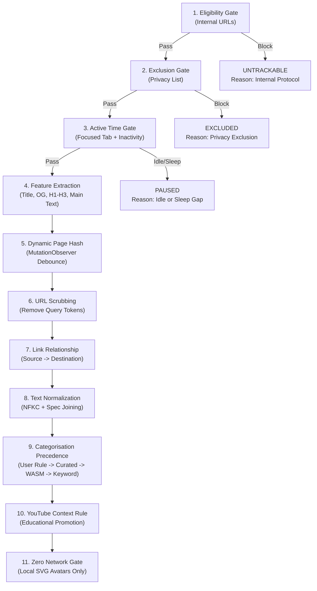

# Atentiv Preprocessing Specification (Single Source of Truth)

**Document:** `docs/architecture/preprocessing-spec.md`  
**Configuration File:** `model/configs/preprocessing.json`  
**Version:** 2.0.0  
**Authority:** Atentiv SRS Revision 3.1 / Submission Version 3.0  
**Enforcement:** TypeScript Runtime (`src/intelligence/`) $\equiv$ Python Offline Pipeline (`model/`)

---

## 1. Specification Objectives

Parity between browser-side runtime feature extraction and offline machine learning dataset preparation is the single most vital invariant of the Atentiv Page Classifier. If runtime text differs from training text by whitespace, token ordering, normalization format, or field ordering, the fastText n-gram embeddings will misalign, severely degrading classification accuracy.

This document formally specifies the canonical text extraction, cleaning, normalization, and composite concatenation rules.

---

## 2. Text Normalization Pipeline

Every input string ($s$) passes through these transformations in exact sequence:

1. **Unicode NFKC Decomposition & Composition:**
   - Converts compatibility characters to canonical equivalents (e.g., fullwidth Latin, ligatures, special spaces).
   - TS: `s.normalize("NFKC")`
   - Python: `unicodedata.normalize("NFKC", s)`

2. **Control Character Elimination:**
   - Strips non-printable ASCII and Unicode control codes:
     `[\u0000-\u0008\u000B-\u001F\u007F-\u009F]` replaced with space `" "`.

3. **URL & Email Redaction:**
   - Web URLs matching `https?://[^\s]+` replaced with space `" "`.
   - Email addresses matching `[a-zA-Z0-9_.+-]+@[a-zA-Z0-9-]+\.[a-zA-Z0-9-.]+` replaced with space `" "`.

4. **Long Digit Run Stripping:**
   - Numbers with 7 or more consecutive digits (session tokens, timestamps, phone numbers) matching `\b\d{7,}\b` replaced with space `" "`.

5. **Allowed Character Retention:**
   - Replace any character not in `[a-zA-Z0-9_ \t\n\r\.\-_]` (`[^\w\s\.\-_]`) with space `" "`.

6. **Case Normalization:**
   - Convert to lowercase:
     - TS: `s.toLowerCase()`
     - Python: `s.lower()`

7. **Whitespace Collapsing & Trimming:**
   - Replace one or more whitespace characters `\s+` with a single space `" "`.
   - Strip leading and trailing whitespace (`.trim()`).

---

## 3. Field Ordering & Length Bounding

The composite text input fed to fastText consists of four structured components joined by a single space (`" "`):

$$\text{CompositeText} = \text{join}(\text{CleanTitle}, \text{CleanDescription}, \text{CleanHeadings}, \text{CleanMainText})$$

| Field Position | Field Name | Extraction Source | Cap Limit |
|---|---|---|---|
| **1** | `title` | `document.title` | Max 300 characters |
| **2** | `description` | `meta[property="og:description"]` or `meta[name="description"]` | Max 500 characters |
| **3** | `headings` | Up to 20 H1, H2, H3 tags | Max 20 items; each max 150 chars |
| **4** | `main_text` | Visible text from `<main>`, `<article>`, `#content` | Max 2048 characters |

### Joining Rules:
- Only non-empty cleaned fields are appended.
- Fields are joined with a single space `" "`.
- The final composite string is clamped to **4096 characters** maximum and trimmed.
- If all fields are empty or the resulting text length is $<3$ characters, the result is empty string `""`.

---

## 4. Gate Sequence & Reason Codes

The runtime pipeline executes these 11 gates in strict order:

---

## 5. Parity Test Enforcement

The continuous integration and build suite verifies parity by running 200 real-world page extracts from `tests/fixtures/golden_preprocessing.json` through both:
- TypeScript: `src/intelligence/runtimePipeline.ts` (`normalizeAndJoinCompositeText`)
- Python: `model/pipeline.py` (`normalize_and_join_composite_text`)

The test suite will fail if a single character differs between the outputs of the two implementations.
