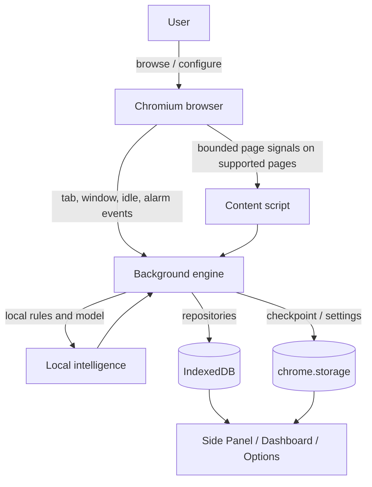

# Data Flow Diagram

No Atentiv backend server is configured in the manifest. This diagram reflects the current packaged architecture and does not imply that every privacy or tracking requirement is verified.
